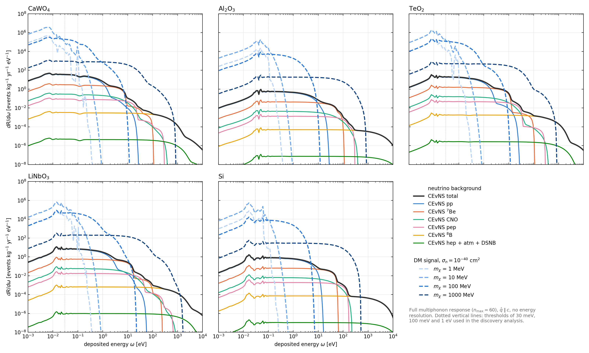
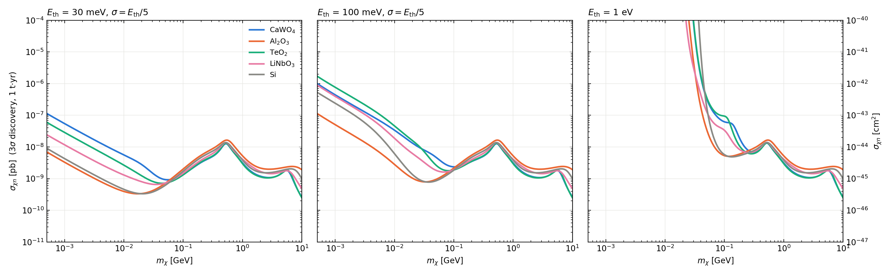
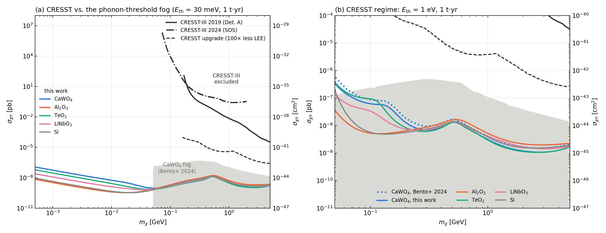
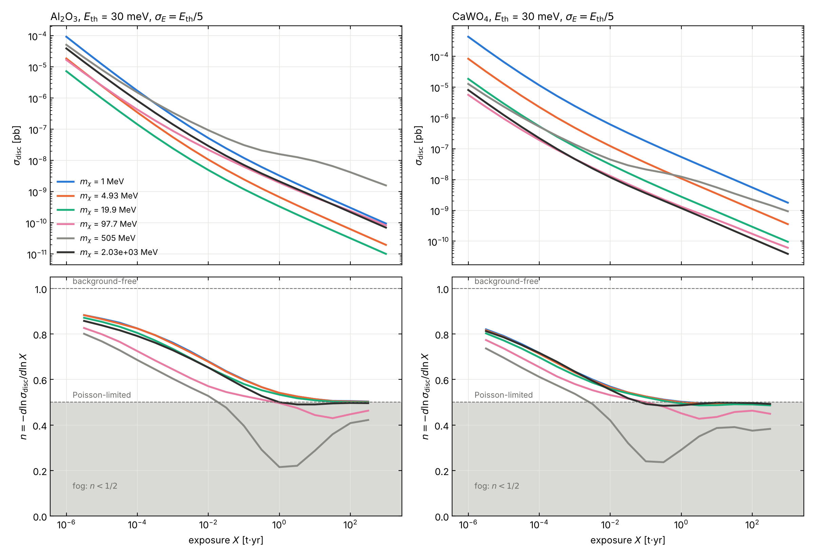
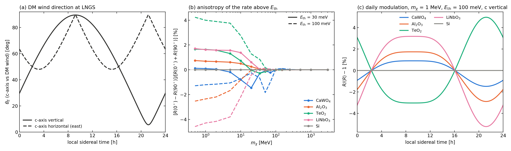

# NuFog — dark matter vs. the neutrino background with the full lattice response

NuFog computes **3σ discovery limits for light dark matter (DM) in cryogenic crystals in the presence of the coherent elastic neutrino–nucleus scattering (CEvNS) background**. It works down to energy thresholds of a few tens of meV. In that regime the energy is absorbed by the crystal lattice through the emission of one or many phonons, not by a free nucleus. Both the DM signal and the neutrino background are therefore computed through the dynamic structure factor $S(\vec q,\omega)$ of the crystal. $S$ is built from first-principles phonon calculations (phonopy) in the incoherent multiphonon approximation, with the impulse approximation at large momentum transfer.

**Supported targets:** CaWO₄, Al₂O₃, TeO₂, LiNbO₃ and Si.

**Main features:**
- multiphonon DM and CEvNS rates (single-phonon → multiphonon → nuclear recoil);
- Asimov discovery test with 11 Gaussian-constrained neutrino-flux nuisance parameters;
- detector threshold and Gaussian energy resolution (CRESST convention σ_E = E_th / 5);
- daily (sidereal) modulation from crystal anisotropy, using the per-atom phonon DOS tensor;
- comparison with CRESST limits and projections;
- fog-index analysis: is the neutrino background a Poisson background or a true "fog"?

The full derivations are in [`docs/NuFog_report.pdf`](docs/NuFog_report.pdf). The development log and every validation step are in [`docs/NuFog_session_summary.md`](docs/NuFog_session_summary.md) and [`docs/CHANGELOG.md`](docs/CHANGELOG.md).

---

## Results at a glance

### Differential rates: neutrino background and DM signal


- **Neutrinos.** CEvNS from pp and ⁷Be neutrinos dominates the meV–eV window. Heavy nuclei (W, Te) concentrate a coherent background ∝ N² below a few eV.
- **Light DM** (1–10 MeV) deposits its energy in the phonon band. Light, stiff crystals (Al₂O₃, Si) put that signal above a 30 meV threshold.

### Discovery limits for five crystals (1 t·yr)


- **Below 50 MeV:** Al₂O₃ and Si are best. CaWO₄ is about 16× weaker at 30 meV, because of a larger background and a signal that falls mostly below threshold.
- **Above 100 MeV:** the heavy targets (CaWO₄, TeO₂) win by 1.3–1.8× through the coherent A² enhancement.

### Comparison with CRESST


- **(a)** CRESST-III and its upgrade projection lie 2–6 orders of magnitude above the neutrino-limited region; CRESST is limited by its low-energy excess. A 30 meV threshold opens the region down to 0.5 MeV.
- **(b)** At E_th = 1 eV our CaWO₄ curve reproduces the shape of Bento et al. (2024).

### Background or fog?


For 1–20 MeV the discovery limit scales as exposure⁻¹ᐟ² (n = ½). The neutrinos act as a Poisson background, and DM remains discoverable with more exposure. A genuine fog (n < ½) appears only near 0.5 GeV, where the DM spectrum mimics ⁸B CEvNS.

### Daily modulation from crystal anisotropy


Anisotropic crystals show a sidereal modulation of a few percent below about 50 MeV, with a phase that reverses with threshold. Si (cubic) shows none.

---

## Repository layout

```
NuFog_v2/
├── config.py                 # all settings (material, grids, threshold, exposure, resolution, halo)
├── nufog_core.py             # S(q, ω), DM and CEvNS rates, binning, energy resolution
├── likelihood.py             # Asimov q0 with exact Newton profiling of flux nuisances
├── dynamic_structure_factor.py   # material database (atoms, masses, A, Z, cell volume)
├── step1_neutrinos.py        # CEvNS spectra per neutrino source
├── step2_dm_matrix.py        # DM spectra on the mass grid
├── step3_discovery.py        # 3σ discovery cross section σ(m_χ)
├── step4_plot.py             # overlay of the cases in config.PLOT_CASES
├── run_all.py                # steps 1–4 for config.PLOT_CASES (one material)
├── run_materials.py          # every discovery curve used by the figures, all materials
├── check_normalization.py    # free-nucleus benchmark (expect ratios 1.000 ± 0.002)
├── compare_v1.py, compare_materials.py, diagnose_spectra.py
├── directional.py, check_directional.py, daily_modulation.py,
│   directional_summary.py, plot_directional.py, compare_stratman_lin.py
├── exposure_scan.py, plot_exposure_scan.py
├── plot_fog_cresst.py, plot_rates.py
├── literature/               # CRESST and Bento et al. curves (published or digitized) + digitizer
├── tools/                    # phonon-tensor builders (phonopy)
├── pDoS_tensor_*.npz         # per-atom phonon DOS tensors (inputs)
├── *.dat                     # neutrino flux tables (pp, ⁷Be lines in code, CNO, ⁸B = test1P.dat, hep, atm, DSNB)
├── data/tensors_superseded/  # older tensors kept for comparison
├── docs/                     # report (PDF + LaTeX), work log, changelog, figures, thesis sections
└── outputs/                  # generated (not tracked by git)
```

---

## Installation

Requires Python ≥ 3.9.

```bash
git clone https://github.com/<your-user>/<your-repo>.git
cd <your-repo>
python3 -m venv .venv && source .venv/bin/activate      # optional
pip install -r requirements.txt
```

`phonopy` is only needed to build new phonon tensors (`tools/`); the pipeline itself needs `numpy`, `scipy` and `matplotlib`.

---

## Quick start (one material)

```bash
NUFOG_MATERIAL=Al2O3 python3 run_all.py          # steps 1–4 for the cases in config.PLOT_CASES
NUFOG_MATERIAL=Al2O3 python3 check_normalization.py
```

The material is chosen with the environment variable `NUFOG_MATERIAL` (`CaWO4` by default, or `Al2O3`, `TeO2`, `LiNbO3`, `Si`).

**Run time and disk use.** The first run of a material builds $S(\vec q,\omega)$, which takes a few minutes, and caches it in `outputs/cache/` (about 180 MB per material and setting). Later runs take seconds. Steps 1–2 are always recomputed, so changing a tensor never reuses stale results.

---

## Reproducing all figures

Run from the repository folder, in this order.

```bash
# 1. Discovery curves for all materials and thresholds (30 meV, 100 meV, 1 eV; with/without resolution; n = 1 and full)
python3 run_materials.py

# 2. Validation
for m in CaWO4 Al2O3 TeO2 LiNbO3 Si; do NUFOG_MATERIAL=$m python3 check_normalization.py; done

# 3. Material comparison and differential rates
python3 compare_materials.py
python3 plot_rates.py                 # -> outputs/rates_dRdw.png

# 4. Neutrino fog vs CRESST
python3 plot_fog_cresst.py            # -> outputs/fog_all_materials.png, outputs/fog_vs_cresst.png

# 5. Background or fog? (exposure scan, E_th = 30 meV, sigma_E = E_th/5)
NUFOG_MATERIAL=Al2O3 python3 exposure_scan.py 0.03 0.2
NUFOG_MATERIAL=CaWO4 python3 exposure_scan.py 0.03 0.2
python3 plot_exposure_scan.py         # -> outputs/exposure_scan.png

# 6. Directionality (daily modulation)
for m in CaWO4 Al2O3 TeO2 LiNbO3 Si; do
    NUFOG_MATERIAL=$m python3 directional.py
    NUFOG_MATERIAL=$m python3 check_directional.py
    python3 daily_modulation.py $m
done
python3 directional_summary.py
python3 plot_directional.py           # -> outputs/directional_modulation.png
python3 compare_stratman_lin.py       # Al2O3 benchmark vs Stratman & Lin (arXiv:2411.03433)
```

---

## Configuration (`config.py`)

| Setting | Default | Meaning |
|---|---|---|
| `MATERIAL` | `CaWO4` (env `NUFOG_MATERIAL`) | Target crystal |
| `Q_DIR` | `'z'` | Momentum direction for the projected DOS: `'z'` (c-axis), `'x'`, `'avg'` (Tr D/3) or a vector |
| `E_TH_KEV` | `3e-5` (30 meV) | Analysis threshold |
| `RESOLUTION_FRAC` | `0.2` | σ_E / E_th (0 = perfect resolution) |
| `EXPOSURE_KG_YR` | `1000` | Exposure (1 t·yr) |
| `N_MAX` | `60` | Phonon number in the DM signal (`1` = single phonon only) |
| `N_MAX_NEUTRINO` | `60` | Phonon number for the neutrino background |
| `DOS_IR_CUTOFF_MEV` | `2.0` | Below this, the DOS is replaced by the acoustic form D ∝ ω² |
| `M_CHI_MIN_MEV`, `M_CHI_MAX_MEV`, `N_MASSES` | 0.5, 10000, 200 | DM mass grid |
| `RHO_CHI_GEV_CM3`, `V0_KMS`, `VE_KMS`, `VESC_KMS` | 0.3, 220, 232, 544 | Standard Halo Model |
| `DISCOVERY_Q0` | `9` | Asimov q₀ for discovery (3σ) |
| `TENSOR_FILES` | — | Phonon tensor for each material |

Outputs are labelled with every setting that affects them (for example `discovery_Eth0.03eV_res0.2Eth_1tyr_Al2O3_Emin0.001eV_qc_m0.5-10000MeV_n60.csv`, with columns `m_chi_GeV, sigma_cm2, sigma_pb`).

---

## Physics in brief

**Lattice response.** Incoherent approximation, harmonic crystal at T = 0:

$$S(\vec q,\omega)=\frac{2\pi}{V}\sum_d A_d^2F_d^2(q)\,e^{-2W_d}\sum_{n\ge1}\frac{1}{n!}\left(\frac{q^2}{2m_d}\right)^{n}T_{d,n}(\omega),\qquad T_{d,1}=\frac{D_d^{\hat q}(\omega)}{\omega},\quad W_d=\frac{q^2}{4m_d}\left\langle\frac1\omega\right\rangle_d.$$

Here $D_d^{\hat q}=\hat q\cdot D_d\cdot\hat q$ is the projected per-atom phonon DOS and $T_{d,n}$ is the n-fold convolution of $T_{d,1}$. Above $q=4\sqrt{2m_d\bar\omega_d}$ the response becomes a Gaussian centred on $q^2/2m_d$ (impulse approximation).

**DM rate:**

$$\frac{dR}{d\omega}=\frac{1}{\rho_T}\frac{\rho_\chi}{m_\chi}\frac{\sigma_n}{4\pi\mu^2}\int q\,dq\;\eta\!\left(\frac{q}{2m_\chi}+\frac{\omega}{q}\right)S(q,\omega).$$

**CEvNS rate.** The same $S$ with $Q_W^2$ in place of $A^2$:

$$\frac{dR}{d\omega}=\frac{1}{\rho_T}\frac{G_F^2}{8\pi^2}\int dE_\nu\frac{d\Phi}{dE_\nu}\int q\,dq\left(1-\frac{q^2}{4E_\nu^2}\right)S_\nu(q,\omega),\qquad Q_W=N-(1-4\sin^2\theta_W)Z.$$

**Statistics.** Poisson likelihood over 200 log bins (1 meV–100 keV) with 11 flux nuisances (⁸B, hep, atm, DSNB, ¹⁵O, ¹³N, ¹⁷F, pp, ⁷Be×2, pep). The Asimov $q_0=9$ defines the 3σ discovery cross section.

See [`docs/NuFog_report.pdf`](docs/NuFog_report.pdf) for the full derivations, the sum rules and the fog-index argument.

---

## Phonon tensors

The per-atom DOS tensors $D_d^{ij}(\omega)$ are built from phonopy force constants on a full Γ-centred mesh, without mesh symmetry (required for atom-projected quantities). The non-analytic LO–TO correction is applied when Born charges are available.

```bash
# any material (phonopy_params.yaml, or phonopy_disp.yaml + FORCE_SETS, optional BORN)
python3 tools/make_tensor_any.py --yaml phonopy_params.yaml --mesh 24 24 24 --out pDoS_tensor_NEW.npz
python3 tools/make_tensor_any.py --yaml phonopy_disp.yaml --force-sets FORCE_SETS --born BORN \
        --mesh 40 40 40 --out pDoS_tensor_NEW.npz

# CaWO4 from phonopy.yaml + FORCE_SETS in the current folder
python3 tools/make_tensor_CaWO4.py 32 32 16
```

To add a material, register the file in `config.TENSOR_FILES`. Add the atoms (order as in the tensor), A, Z, masses and the primitive-cell volume to `MATERIAL_DATABASE` in `dynamic_structure_factor.py`. Then run `check_normalization.py`.

| Material | Tensor | Status |
|---|---|---|
| CaWO₄ | `pDoS_tensor_v5_mesh32x32x16_CaWO4.npz` | 2×2×1 supercell; acoustic slopes 20–40% low (**systematic at low mass**) |
| Al₂O₃ | `pDoS_tensor_v4_mesh100.npz` | Validated with LO–TO; sound speeds within about 5% |
| TeO₂ | `pDoS_tensor_TeO2_reordered.npz` | Atom order corrected; no force constants to cross-check |
| LiNbO₃ | `pDoS_tensor_LiNbO3.npz` | Good along c; small in-plane imaginary pocket |
| Si | `pDoS_tensor_Si_phonondb.npz` | Phonon database, 64-atom supercell; TA about 15% soft |

---

## Validation

| Check | Result |
|---|---|
| Free-nucleus limit (above 1 eV), all materials | within 0.1% |
| Phonon sum rules ($\int S\,d\omega$ and f-sum) | within about 1% at all q |
| Newton profile vs L-BFGS-B | $\lvert\Delta q_0\rvert < 2\times10^{-3}$ |
| Directional code: average over $\vec v_E$ vs isotropic rate | $10^{-4}$ (Si), 0.3% (CaWO₄) |
| Daily modulation, Al₂O₃, vs Stratman & Lin | Same magnitude, threshold dependence and mass range |
| CaWO₄ at 1 eV vs Bento et al. (2024) | Same shape; ratio 0.61–0.78 |

---

## Limitations

- **Incoherent approximation.** It is not valid below a few keV of momentum transfer. Single-phonon coherence and dispersion are not included (relevant below about 1 MeV and for directionality).
- **Model of the crystal.** The calculation is harmonic and at T = 0.
- **Assumed knowledge.** The phonon response and the halo are taken as exactly known. An uncertainty on $S(\vec q,\omega)$ would act as an additional systematic (see Sec. 11 of the report).
- **Digitized curves.** Literature curves other than CRESST-III 2019 are digitized from figures, with about 10% accuracy in σ.

---

## References

- CRESST Collaboration, *The CRESST experiment towards the next generation of sub-GeV direct dark matter detection*, Commun. Phys. (2025), doi:10.1038/s42005-025-02476-5
- A. Bento et al., *Solar neutrinos in cryogenic detectors*, Eur. Phys. J. C 84, 1118 (2024)
- B. Campbell-Deem, S. Knapen, T. Lin, E. Villarama, Phys. Rev. D 106, 036019 (2022)
- S. Knapen, J. Kozaczuk, T. Lin, *DarkELF*, Phys. Rev. D 105, 015014 (2022)
- C. Stratman, T. Lin, arXiv:2411.03433
- S. Griffin, S. Knapen, T. Lin, K. M. Zurek, Phys. Rev. D 98, 115034 (2018)
- C. A. J. O'Hare, Phys. Rev. Lett. 127, 251802 (2021); data: github.com/cajohare/NeutrinoFog

## Author

Israel Hernández — PhD project on cryogenic detectors for dark matter and CEvNS.
